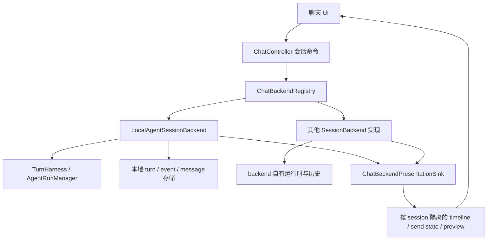

# 会话后端边界

## 目标与范围

一个 Flutter 应用可以同时运行不同 Agent 后端拥有的会话。每个会话在创建时绑定一个 backend，执行期间归属不变。当前已接通本地 Agent；后端契约允许后续注册 DSH 实现。本阶段不包含 DSH 协议接入、会话转后端或跨后端迁移。

本地 Agent 的功能完整性优先于抽象统一。它继续拥有自己的 `ChatTurn`、`ChatTurnStep`、`ChatEvent`、`TurnHarness`、`AgentRunManager`、工具策略、运行恢复和 SQLite transcript。其他 backend 不需要伪造这些本地对象。

## 分层

`ChatSessionBackend` 是命令和历史读取边界，`ChatBackendRegistry` 按持久化的 backend ID 解析实现。`ChatBackendSession` 同时携带应用会话 ID 与不透明 backend session ID。执行、交互 ID 均由 backend 创建并由原 backend 消费。

`ChatBackendPresentationSink` 将历史页、消息更新、流式 preview、执行状态和 pending interaction 写入当前 session 的应用投影。sink 固定绑定 session；删除 session 会提升 presentation generation，使旧 sink 的迟到事件失效。

## 持久化归属

- `chat_groups.backend_id` 确定会话 backend；`backend_session_id` 仅保存 backend 侧标识。
- 新建会话默认 `local_agent`。版本 18 及更早的数据库升级到版本 19 时，为现存会话填充 `local_agent`，不重建历史表。
- backend ID 在会话生命周期内固定。当前没有更改 backend ID 的 UI 或迁移 API。
- 本地 Agent 的消息、turn、step、event 和恢复点由本地存储管理。
- 其他 backend 的 transcript 与运行状态由 backend 自己持有。应用侧通用 timeline message 是展示投影，不代表其他 backend 必须写入本地 transcript 表。

## 行为与能力

`ChatBackendCapabilities` 描述停止、Steer、Queue、工具确认、结构化回答、分页、附件和流式 preview 能力。输入区、确认入口和分页操作按当前会话能力启用。未持久化草稿默认拥有本地 Agent 的完整能力，保持现有新会话体验。

本地 backend adapter 将 send、stop、工具确认/取消、AskUserQuestion 回答、history 分页和会话删除转交现有本地实现。对本地 turn、工具检查点、Steer / Queue、运行池以及 preview final takeover 的既有语义不做数据格式替换。

其他 backend 可采用不同执行状态和交互类型，通过 opaque execution/interaction reference 与通用 presentation model 暴露给 UI。通用交互组件只适用于 backend 没有专用的共享交互卡片时；本地工具审批和 AskUserQuestion 仍使用现有投影和卡片。

## 回归要求

任何 backend 边界调整都必须同时证明：

- 本地 Agent 的 send、stop、确认、回答、并发会话、分页、preview takeover 和启动恢复继续通过真实 `TurnHarness` parity 测试。
- 旧库升级保留消息、turn 和等待中的审批状态，既有行继续绑定本地 Agent。
- fake backend 与本地会话可在同一 ProviderContainer 交替运行；fake 的 history、执行状态、交互、停止与迟到事件按 session 隔离，且不写本地 turn/event 表。
- backend 缺少能力时对应操作不可触发；新建本地草稿仍保留本地 Agent 原有能力。

详细阶段门槛见[双 Agent 后端改造计划](../superpowers/plans/2026-11-22-dual-agent-backend-implementation-plan.md)。
