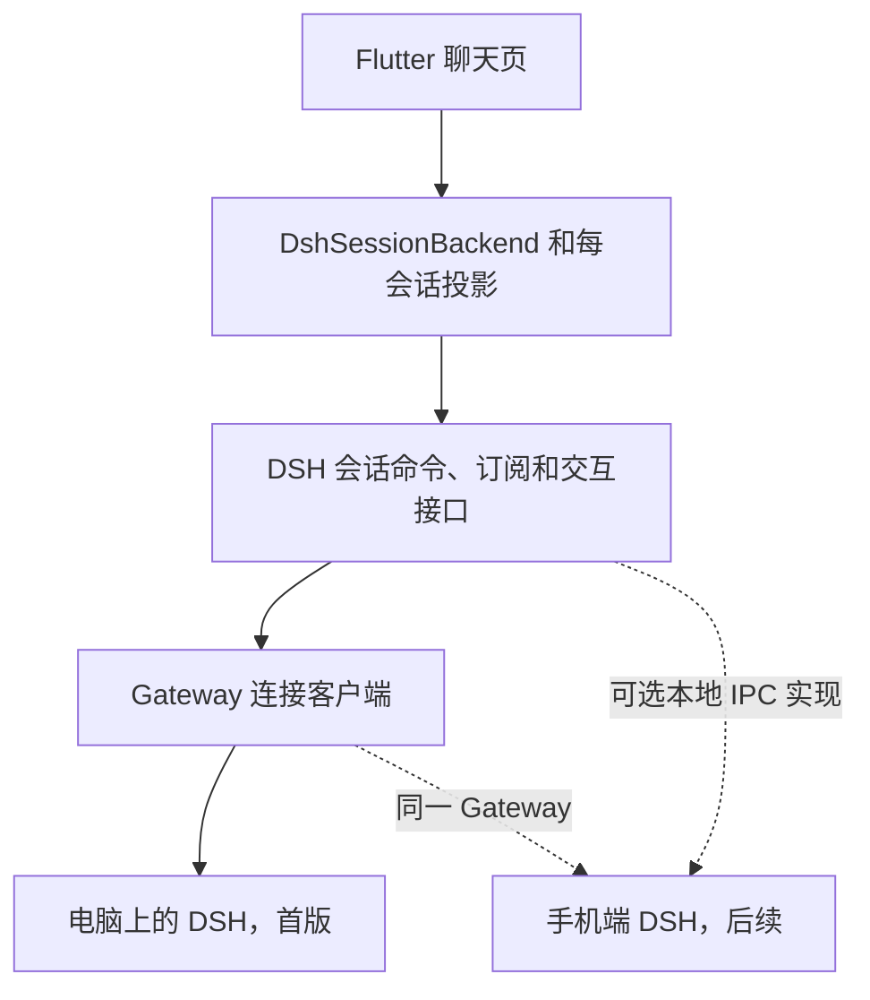

# DSH 远程后端首版实施计划

## 首版目标

电脑运行 DSH Web profile，手机使用 Flutter 聊天页访问电脑上的 DSH。首版交付连接、创建和重开会话、发送文本、流式回复、历史分页、停止、通用工具卡片、审批和结构化问答。以 Android 真机作为首个验收目标。开发设置选择新会话的默认后端，已创建的会话保留原归属。

首版范围限单个配置好的 DSH 宿主。附件上传、队列编辑、Steer 控件、专用工具卡、DSH 原生会话目录导入、永久删除和手机端运行时打包列入后续阶段。DSH 已经接受的排队输入仍由 DSH 管理，首版停止当前 turn 后按宿主实际状态展示后续执行。

## 复用边界

连接端点、认证和宿主启动归连接及宿主层。Flutter 直接连接 Gateway。`DshTransport` 提供命令和订阅，`DshSessionBackend` 保留会话命令、交互与重连后的数据恢复。将来采用端内 Gateway 时可继续使用同一传输实现，采用本地 IPC 时通过相同的命令和订阅接口接入。

## 实施顺序

### 1. 验证真实 Gateway 协议

- [x] 按协议映射草案固定 DSH 源码版本，使用 Web profile 和 Gateway 的 `/connect` 完成认证。调试版凭证仅保存在进程内。连接诊断使用固定提示。
- [x] 使用 `scripts/probe_dsh_gateway.dart` 在真实 Gateway 上验证会话创建、订阅、读取、发送和停止。受控模型分别产生了 `completed` 与 `aborted` 终态。
- [ ] 验证 Gateway Remote Events 双向往返，分别处理一次审批及一次问答，并观察宿主取消请求时客户端收到的信号。
- [ ] 通过条件是探针在目标电脑与手机的网络环境建立认证连接，在同一连接上完成命令、流和交互响应。若某一项无法完成，先定下连接或桥接实现，再接聊天页。

### 2. 接入会话目录与命令

- [ ] 注册 `DshSessionBackend`，提供开发设置中的宿主地址、连接状态和新会话默认后端。连接未就绪时在 DSH 会话内显示重试入口。
- [ ] 创建时建立 Flutter 会话 ID、DSH 宿主身份和实际 `sessionId` 的映射。保留创建失败后的重试信息。切换宿主配置时核对已绑定会话的宿主，避免把同一个 session ID 发送给另一台电脑。
- [ ] 将接受回执、停止请求回执和 turn 终态分别处理。发送重试沿用原 `requestId`，并用 DSH 的确认信息接管用户消息回显。首版 Flutter 目录可提供明确的「从此设备移除」操作，DSH 历史保留。

### 3. 接入时间线与恢复

- [ ] 让 DSH 会话订阅独立于一次发送和页面生命周期。按会话标识维护 durable `seq`、assistant attempt 和连接代次。切换页面只切换 UI 观察对象，重连后由基线和连续事件恢复显示。
- [ ] 接通历史分页，固定历史读取的 `throughSeq` 并按最早事件向前翻。即使一页投影后没有可见消息，也按后端的 `hasMore` 与游标继续读取。
- [ ] 映射文本、reasoning、工具调用及结果。实时预览由对应正式事件接管。中断时保留 DSH 已确认的部分输出。工具调用与结果按 `callId` 合并，用户时间线保留压缩前已经展示的消息。

### 4. 接入审批与问答

- [ ] 给通用交互模型增加有类型的审批和问答字段。绑定原会话及请求身份，通过 Gateway 回传真实响应。审批范围取决于宿主给出的能力，问答保留选项、多选、自由输入、详情和取消语义。
- [ ] 展示正在等待、已处理、取消或失效等状态。用真实的待处理请求启用按钮。宿主取消或会话切换时按请求身份处理，避免错答另一会话。

### 5. 真机验收与本地 Agent 回归

- [x] 构建和启动 macOS 调试版，确认签名包含出站网络权限。可用本机 DSH 调试 Gateway 与聊天页，Android 的网络和应用生命周期仍需设备验收。
- [ ] Android 真机同时运行两个 DSH 会话。A 输出中切到 B 发送，返回 A 停止，确认 A 保留部分输出且 B 继续。再次分别触发审批和问答，确认响应正确路由。
- [ ] 模拟网络中断、电脑宿主重启、Flutter 重开。确认已确认内容可重新读取，历史与实时事件无重复或缺失，过期交互不可提交。宿主重启后按实际持久化状态展示终态。
- [ ] 用真实协议样例做可重复回放，覆盖回执去重、预览接管、旧连接迟到帧、空投影分页和交互取消。用同一个会话协议接口替换传输实现，验证 Flutter 上层可复用。
- [ ] 通过现有本地 Agent 的发送、停止、审批、问答、Steer、Queue、并发、历史分页和启动恢复回归。更新 README、架构文档和 debug 验收用例，并记录首版支持的 DSH 版本。

事件和字段映射见 [DSH 前台协议映射草案](../specs/2026-11-23-dsh-ui-protocol-mapping.md)。
