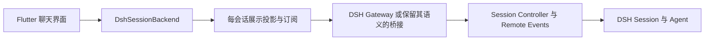

# DSH 前台协议映射草案

依据 DSH checkout `4b399c39a6` 与 Flutter 的会话后端契约 `cf32bfe`。本文描述接入方案及待验证项，移动端进程和传输方式留待单独评估。

## 分层与对象归属

Flutter 会话目录保存固定的 `backendId` 和 `backendSessionId`。DSH 持有执行、排队和历史。连接可以共享，历史窗口、运行状态、预览与交互按 DSH 会话隔离。创建会话以 `session.create` 返回的实际 ID 为准，后续重连沿用该 ID。Flutter 目录写入与 DSH 创建分属两个存储，需记录创建结果并处理其中一步失败，避免重试产生重复会话。

## 命令与状态

| Flutter 入口 | DSH GUI 协议 | 展示语义 |
| --- | --- | --- |
| 创建会话 | `session.create` | 建立 Flutter 与 DSH ID 的绑定 |
| 发送、排队、Steer | `session.prompt`，携带 `sessionId`、`requestId`、`mode`、有序 `content` | `accepted` 表示已入队。重试沿用 `requestId`，用队列项或 `user/message.source.rpcId` 对齐临时回显 |
| 停止 | `session.cancel` | 请求取消当前 turn，保留队列。收到执行终态后更新该 turn，再显示下一条排队输入的实际状态 |
| 队列管理 | `session.updateQueue` | 使用 DSH inbox item ID 提交编辑、移除或转为 Steer |
| 当前状态 | `session.state` / `session.observeState` | `running` 和队列来自 DSH。预览及等待输入单独合并。`pendingInput` 的变化单独发生时不会触发 `observeState` |
| 历史与实时订阅 | `session.events` / `session.follow` | 按会话地址读取，支持冷读。是否激活 Agent 由 `follow.activate` 决定 |
| 删除 | 待核对宿主提供的操作 | 已确认的 `workspace.archiveSession` 表示归档。永久删除及 Flutter 目录移除的关系需要明确 |
| 附件 | `session.prompt.content` 与宿主上传服务 | 图片可携带编码数据，文件用同会话的 upload receipt，历史媒体通过宿主引用解析 |

`session.control` 提供宿主级投影基线及更新，可用于列表元数据。当前运行的 `turn/end` 与整个 Agent 的空闲是两个事实。送入队列的多条输入可能相继执行，发送回执、turn 终态与队列清空应各自更新。

## 时间线与实时预览

1. 打开会话时用 `session.follow` 的 `snapshot` 建立历史窗口。记录最后接收的 durable `seq`，再接受连续的事件。断线后以新连接基线重新对齐，按会话与 `seq` 去重，废弃旧订阅的回调。
2. 向前翻页固定 `throughSeq`，用窗口最早序号作为下一页的 `beforeSeq`。DSH 分页以事件窗口和消息预算为基础。投影过滤后可能出现零条可见消息，继续按后端游标与 `hasMore` 判断还有没有历史。到达跨页 turn 时按稳定身份合并，实时追加可独立进行。
3. 用户时间线主要取 append 原始事件。`user/message` 按来源区分人工输入与注入上下文，`assistant/message` 逐块处理文本及 reasoning。模型上下文的压缩替换不会覆盖用户已经看到的消息，压缩检查点是否展示由 UI 单独决定。
4. 工具状态用 DSH `callId` 合并 `tool/call` 与 `tool/result`，并避免把助手消息里的同一 tool call 块再渲染一遍。结果的 `meta` 由工具解释，首版可展示工具名、状态和可见结果，具体卡片逐个适配。没有展示需要的 request/header 等日志留在 DSH。
5. `follow(assistantStream: true)` 提供独立的 assistant 帧。根据快照的 active attempt、`attemptId`、`revision` 和 chunk `index` 更新临时预览。`end` 的 `committed` 指向 durable seq，收到对应事实后完成交接。`assistant/message` 接管正式展示，`assistant/attempt` 结束临时预览而没有正式消息。`abandoned` 清理临时预览。中断若落下 `assistant/message.interrupted`，保留已收到的输出并标为中断。

建议稳定身份使用 `(sessionId, messageId)`、`(sessionId, turn)` 和 `(sessionId, callId)`，预览另加 `attemptId`。确认 Flutter timeline 能保留这些身份，再决定使用外部键还是适配层的稳定 ID 映射。

## 审批与问答

| 场景 | DSH 官方 GUI 路径 | Flutter 映射 |
| --- | --- | --- |
| 正在等待审批 | Gateway Remote Event `approval/request` | 按会话与请求呈现审批卡片，保留原请求的回答通道和取消信号。关联工具调用是展示用途，审批标识独立保留 |
| 审批历史 | `approval/asked`、`approval/decided` | 可回放展示，只有当前 live 请求可呈现可操作按钮 |
| 正在等待问答 | Remote Event `user-questions/request` | 保留问题 ID、选项、自由输入、详情和原请求取消信号 |
| 支持延后回答的问答 | `userQuestions.answer(sessionId, callId, answer)`，前台定时等待另有 `attachWait` | 依据实际问答模式决定回答通道。区分用户取消、等待结束和断线，迟到回答按宿主结果处理 |

SDK JSON-RPC 的 `user-question/ask`、`user-question.cancelled` 与审批响应词汇属于 SDK 协议。实现 GUI 路径时以 Gateway 的请求及返回类型为准。现有 Flutter 的通用标题、提示文案和字符串按钮不足以表达完整问答，首版接入交互时需加入带类型的展示数据和请求引用。

## 接入成本与验收

| 范围 | 预计改动集中处 | 验收场景 |
| --- | --- | --- |
| 文本流、查看历史、停止 | DSH 适配与事件投影。Flutter 补创建绑定、持续订阅及明确的终态 | A 会话流式输出时切到 B 发送并返回 A。停止 A 后保留部分输出，B 继续运行。断线恢复后确认无重复或缺条 |
| 完整历史与分页 | 处理跨页关联、快照与实时事件合并 | 加载上一页的同时等待新输出。页内只有隐藏事件时仍能继续翻页。压缩前后的可见历史一致 |
| 审批、问答、队列 | Gateway 双向事件、Flutter 类型化卡片与队列命令 | A 等审批、B 等问答，分别操作。取消或过期后迟到回复不能改动已结束的交互。停止后验证责任会话的队列仍在 |
| 文件与工具展示 | 宿主上传和媒体读取、按工具适配卡片 | 附件回放和权限范围清晰。未知工具仍能查看通用结果 |

当前 Flutter `ChatSessionBackend` 提供会话命令、历史页和展示 sink。sink 目前用删除时递增的 generation 屏蔽旧写入，重连及同会话多次运行还需由 DSH 适配层按订阅和 attempt 管理。外部分页路径遇到空消息页会结束分页，接入时需由适配层消化空投影页，或调整共用分页规则以尊重后端游标。优先验证这些新增语义能在两个 DSH 会话并发时成立，并用现有本地 Agent 回归覆盖共享改动。

## 源码依据

- DSH 会话命令和帧结构见 [Session Controller][dsh-controller] 与 [协议类型][dsh-types]。
- 用户时间线与模型 surface 的区别见 [surface.ts][dsh-surface] 与 [官方 UI 消息投影][dsh-messages]。
- 官方交互入口见 [审批客户端][dsh-approvals]、[问答客户端][dsh-questions] 与 [问答服务][dsh-question-service]。
- Flutter 对照见 [ChatSessionBackend](../../../lib/services/chat_backends/chat_backend_contract.dart)、[会话协调器](../../../lib/controllers/chat_session_coordinator.dart) 与 [展示 sink](../../../lib/providers/chat_backend_providers.dart)。

[dsh-controller]: https://github.com/deepseek-ai/deepseek-harness/blob/4b399c39a6d1479cd84ca591b4d7c88e24d38a96/packages/api/session-controller/src/index.ts
[dsh-types]: https://github.com/deepseek-ai/deepseek-harness/blob/4b399c39a6d1479cd84ca591b4d7c88e24d38a96/packages/api/session-controller/src/types.ts
[dsh-surface]: https://github.com/deepseek-ai/deepseek-harness/blob/4b399c39a6d1479cd84ca591b4d7c88e24d38a96/packages/core/session/src/surface.ts
[dsh-messages]: https://github.com/deepseek-ai/deepseek-harness/blob/4b399c39a6d1479cd84ca591b4d7c88e24d38a96/packages/client/ui-chat/src/client/conversation-nodes/message.ts
[dsh-approvals]: https://github.com/deepseek-ai/deepseek-harness/blob/4b399c39a6d1479cd84ca591b4d7c88e24d38a96/packages/client/ui-approval/src/client/index.ts
[dsh-questions]: https://github.com/deepseek-ai/deepseek-harness/blob/4b399c39a6d1479cd84ca591b4d7c88e24d38a96/packages/client/ui-user-questions/src/client/index.ts
[dsh-question-service]: https://github.com/deepseek-ai/deepseek-harness/blob/4b399c39a6d1479cd84ca591b4d7c88e24d38a96/packages/interaction/user-questions/src/index.ts
